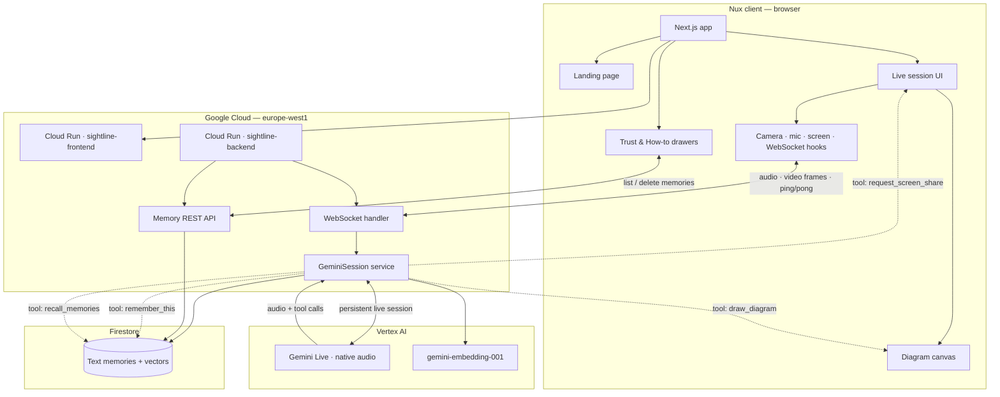

# Nux

---

**A real-time collaborative agent that works with you — built on Gemini Live.**

Nux runs continuously in one live session. Point your camera, share your screen when you choose, speak naturally, and the agent sees what you show it, remembers what you ask it to, and draws diagrams when you need to go deeper. Not a chatbot. A collaborative presence — it works alongside you, not instead of you.

---

## Live Demo

**App:** https://sightline-frontend-59597652459.europe-west1.run.app  
**API docs:** https://sightline-backend-59597652459.europe-west1.run.app/docs  
**Demo video:** [Watch on YouTube](https://www.youtube.com/watch?v=hW1gJ22O3Zs)

---

## What it does

```
"What is photosynthesis?" → remember this → look at my notes → draw how it works
```

One continuous WebSocket session handles everything:

1. **Camera** — JPEG frames to Gemini every 1.5s (physical world)
2. **Screen share** — opt-in desktop screen capture for notes, code, apps (user must approve)
3. **Mic audio** — PCM16 at 16kHz, streamed in real time
4. **Gemini Live** — sees frames, hears you, responds in voice, calls tools on demand
5. **Memory** — Firestore vector search; save and recall facts across sessions
6. **Drawing canvas** — labeled SVG diagrams when you ask it to visualize a concept
7. **Turn management** — mic mutes while the agent speaks, reopens on `turn_complete`

---

## Architecture



**How it fits together**

| Layer | Role |
|-------|------|
| **Nux frontend** | Marketing landing (`Landing`, portrait) and live session (`page.tsx`). Trust & How-to open as Vaul drawers; memories load over REST. |
| **WebSocket** | One long-lived connection per user — mic audio, camera/screen JPEG frames, Gemini audio back, tool side-effects (`turn_complete`, diagram JSON, share prompt). |
| **Gemini Live** | Sees frames, hears speech, speaks responses, invokes tools. Session loop keeps `receive()` alive across turns. |
| **Firestore** | Stores distilled text memories with embeddings only — never raw video or audio. |
| **Cloud Run** | `sightline-frontend` (port 3000) and `sightline-backend` (port 8080) in `europe-west1`, GCP project `sightline-2026`. Ping/pong every ~20s avoids proxy idle timeouts. |

**Deployed today:** UI brand is **Nux**. Hosted on free Cloud Run URLs (`*.run.app`). GCP project `sightline-2026`, services `sightline-frontend` / `sightline-backend`. Custom domain is optional and not required.

---

## Running locally

```bash
git clone https://github.com/rkchellah/sightline.git
cd sightline
```

**Backend:**

```bash
cd backend
python -m venv .venv

# Windows
.venv\Scripts\Activate.ps1
# Mac/Linux
source .venv/bin/activate

pip install -r requirements.txt
python -m uvicorn app.main:app --reload --port 8000 --ws websockets
```

**Frontend** (second terminal):

```bash
cd frontend
npm install
npm run dev
```

Create `frontend/.env.local`:

```bash
NEXT_PUBLIC_WS_URL=ws://localhost:8000/ws
NEXT_PUBLIC_API_URL=http://localhost:8000
```

Open http://localhost:3000, click **Talk with Nux**, grant camera and microphone access.

If the button stays on **Connecting…**, the backend is not reachable at `NEXT_PUBLIC_WS_URL`. Start the backend first, then refresh the frontend.

---

## Deploy (Cloud Run)

From the repo root, build and deploy both services:

```bash
gcloud builds submit --config=cloudbuild.yaml --project=sightline-2026
```

That builds Docker images, pushes to Artifact Registry, and deploys:

| Service | Port | Image |
|---------|------|--------|
| `sightline-backend` | 8080 | `europe-west1-docker.pkg.dev/sightline-2026/cloud-run-source-deploy/sightline-backend:latest` |
| `sightline-frontend` | 3000 | `europe-west1-docker.pkg.dev/sightline-2026/cloud-run-source-deploy/sightline-frontend:latest` |

**Backend only** (manual):

```bash
cd backend
docker build -t europe-west1-docker.pkg.dev/sightline-2026/cloud-run-source-deploy/sightline-backend:latest .
docker push europe-west1-docker.pkg.dev/sightline-2026/cloud-run-source-deploy/sightline-backend:latest

gcloud run deploy sightline-backend \
  --image=europe-west1-docker.pkg.dev/sightline-2026/cloud-run-source-deploy/sightline-backend:latest \
  --region=europe-west1 \
  --allow-unauthenticated \
  --port=8080 \
  --memory=512Mi \
  --timeout=300 \
  --set-env-vars=GOOGLE_CLOUD_PROJECT=sightline-2026,GOOGLE_CLOUD_LOCATION=europe-west1
```

After deploy, check: `curl https://sightline-backend-59597652459.europe-west1.run.app/health`

The frontend build bakes in `NEXT_PUBLIC_WS_URL` and `NEXT_PUBLIC_API_URL` (see `cloudbuild.yaml`).

---

## Google Cloud setup

```bash
gcloud auth application-default login
gcloud auth application-default set-quota-project sightline-2026
gcloud services enable aiplatform.googleapis.com --project=sightline-2026
```

The backend connects to Vertex AI via Application Default Credentials — no API keys in the codebase.

```python
self.client = genai.Client(
    vertexai=True,
    project="sightline-2026",
    location="europe-west1"
)
```

---

## Stack

- **Frontend**: Next.js, TypeScript, WebRTC, `getDisplayMedia`
- **Backend**: FastAPI, Python 3.11, asyncio
- **AI**: Gemini Live (`gemini-live-2.5-flash-native-audio`) via Vertex AI
- **Memory**: Firestore native + vector search, `gemini-embedding-001`
- **Auth**: Application Default Credentials (no exposed keys)
- **Transport**: WebSocket — JSON + base64 encoded audio/frames
- **Hosting**: Google Cloud Run, region `europe-west1`

---

## Project structure

```
sightline/                         # repo folder; product UI is Nux
├── backend/
│   └── app/
│       ├── main.py                    — FastAPI entry point
│       ├── api/websocket.py           — WebSocket handler + keepalive
│       ├── api/memory.py              — Memory list/delete REST API
│       ├── core/config.py             — GCP project + model config
│       ├── services/gemini_service.py — Live session, tools, turn loop
│       └── services/memory_service.py — Firestore vector memory
└── frontend/
    ├── app/
    │   ├── page.tsx                   — Landing + session UI
    │   ├── layout.tsx                 — Metadata + fonts
    │   ├── icon.svg / favicon.ico     — Nux favicon
    │   └── apple-icon.png
    ├── components/
    │   ├── Landing.tsx                — Marketing landing
    │   ├── NuxPortrait.tsx            — Hero portrait
    │   ├── CameraView.tsx
    │   ├── DiagramCanvas.tsx
    │   ├── TrustPanel.tsx
    │   ├── HowToPanel.tsx
    │   ├── PanelCard.tsx
    │   ├── AudioVisualizer.tsx
    │   └── VoiceOverlay.tsx
    └── hooks/
        ├── useCamera.ts
        ├── useScreenShare.ts
        ├── useWebSocket.ts
        ├── useMemories.ts
        └── useAudioPlayer.ts
```

---

## What I learned building this

Five problems that weren't in any tutorial.

**Gemini hears itself if you don't mute the mic during playback.** When Gemini speaks, its audio comes out of the browser speaker. The mic picks that up, sends it back to Gemini, and the session breaks — Gemini hears its own voice mid-sentence and goes silent permanently. The fix was `isSpeakingRef` in `useAudioPlayer.ts` — a React ref, not state, because refs hold the live value synchronously. The `ScriptProcessorNode` checks `isSpeakingRef.current` on every audio frame; if Gemini is speaking, the frame is dropped before it ever reaches the WebSocket. When the backend detects `turn_complete` in Gemini's response stream, it sends that signal to the frontend, which sets `isSpeakingRef.current = false` and reopens the mic. The reason it has to be a ref and not state is that the audio processor callback captures a stale closure — state updates wouldn't be visible inside it, but a ref always is.

**WebSocket connections to Cloud Run die without a heartbeat.** Cloud Run sits behind a Google-managed proxy with a 60-second idle timeout. A long conversation with natural pauses — the user thinking, Gemini processing — can easily go quiet for more than a minute. The connection drops with no error, just silence. Fixed it with a ping/pong task on both the backend and the browser client, running every 20 seconds, keeping the connection alive regardless of what the conversation is doing.

**The SDK's `receive()` stops listening after every turn — and tool calls exposed it.** When I added memory tools, Gemini went completely mute after saving or recalling a memory. No spoken confirmation, ever. The logs showed `memory_saved` immediately followed by `turn_complete` with zero audio in between. This one was sneaky: my first fix (adding `scheduling=INTERRUPT` to the tool response) was necessary but didn't solve it, and I only found the real cause by pulling raw Cloud Run logs and reading the installed SDK's source directly. It turns out `session.receive()` in the google-genai SDK is a one-turn generator — it breaks itself the moment `turn_complete` arrives. My code called it once per session instead of looping, so the backend stopped listening and tore down the whole connection after every single turn. Normal turns looked fine because their audio streamed before `turn_complete` fired, which hid the bug. But a tool call generates its spoken confirmation as a *new* turn — by the time Gemini tried to speak, nobody was listening. Worse, this meant the session had been silently destroyed and rebuilt on every exchange the whole time: Gemini was losing all conversation context each turn and paying full session-setup cost, and the app still "worked" enough that nobody noticed. The fix was one loop — wrapping `session.receive()` in `while True:` inside `GeminiSession.receive()`, so after each turn completes the backend immediately re-enters the generator on the same session instead of letting it die.

**The live demo can look dead when the app is fine — Cloud Run just won't serve without billing.** From late July through 26 August 2026 the app URL returned Google's generic *Server Error / try again in 30 seconds*, then *Rate exceeded.* Both pages are misleading. `gcloud run services describe` still showed the service **Ready** (last healthy deploy 3 July). The real log line was *The request failed because billing is disabled for this project.* Project `sightline-2026` had `billingEnabled: false`; the linked account (*My Billing Account*) and every other billing account on the login were **closed**. After reopening billing, Cloud Run started a healthy Next.js instance (`Ready in 19.1s`, TCP probe on port 3000 passed, `min-instances=1` provisioned) but the URL kept returning HTTP 429. That second phase is a documented Google known issue: after you re-enable billing, Cloud Run can take **up to 30 minutes** to route traffic again, failing with 429/503 and the log *The request was aborted because there was no available instance* — and there is no manual workaround except waiting. Refreshing during that window makes the 429 last longer. The app code was never the failure.

**Tested on a real user, not a simulator.** Pointed the running app at a family member's phone over a video call. Gemini correctly identified medications in their hand from the camera feed. It also correctly declined to give specific dosage advice — which was the right call, but it meant the app needed better prompting to guide users toward asking safe questions. That feedback came from actual use, not from me testing it on my desk.
