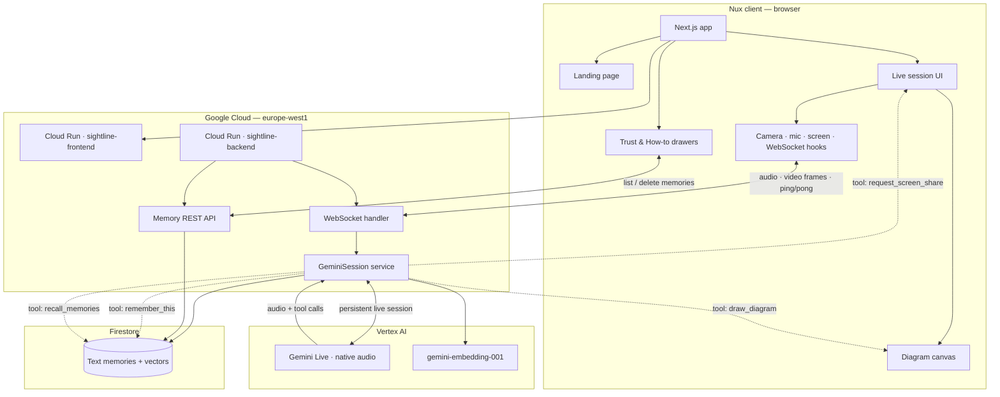

# Nux

---

**A real-time collaborative agent that works with you — built on Gemini Live.**

Nux runs continuously in one live session. Point your camera, share your screen when you choose, speak naturally, and the agent sees what you show it, remembers what you ask it to, and draws diagrams when you need to go deeper. Not a chatbot. A collaborative presence — it works alongside you, not instead of you.

---

## Live Demo

**App:** https://sightline-frontend-59597652459.europe-west1.run.app  
**API docs:** https://sightline-backend-59597652459.europe-west1.run.app/docs  
**Demo video:** [Watch on YouTube](https://www.youtube.com/watch?v=hW1gJ22O3Zs)

---

## What it does

```
"What is photosynthesis?" → remember this → look at my notes → draw how it works
```

One continuous WebSocket session handles everything:

1. **Camera** — JPEG frames to Gemini every 1.5s (physical world)
2. **Screen share** — opt-in desktop screen capture for notes, code, apps (user must approve)
3. **Mic audio** — PCM16 at 16kHz, streamed in real time
4. **Gemini Live** — sees frames, hears you, responds in voice, calls tools on demand
5. **Memory** — Firestore vector search; save and recall facts across sessions
6. **Drawing canvas** — labeled SVG diagrams when you ask it to visualize a concept
7. **Turn management** — mic mutes while the agent speaks, reopens on `turn_complete`

---

## Architecture



**How it fits together**

| Layer | Role |
|-------|------|
| **Nux frontend** | Marketing landing (`Landing`, portrait) and live session (`page.tsx`). Trust & How-to open as Vaul drawers; memories load over REST. |
| **WebSocket** | One long-lived connection per user — mic audio, camera/screen JPEG frames, Gemini audio back, tool side-effects (`turn_complete`, diagram JSON, share prompt). |
| **Gemini Live** | Sees frames, hears speech, speaks responses, invokes tools. Session loop keeps `receive()` alive across turns. |
| **Firestore** | Stores distilled text memories with embeddings only — never raw video or audio. |
| **Cloud Run** | `sightline-frontend` (port 3000) and `sightline-backend` (port 8080) in `europe-west1`, GCP project `sightline-2026`. Ping/pong every ~20s avoids proxy idle timeouts. |

**Deployed today:** UI brand is **Nux**. Hosted on free Cloud Run URLs (`*.run.app`). GCP project `sightline-2026`, services `sightline-frontend` / `sightline-backend`. Custom domain is optional and not required.

---

## Running locally

```bash
git clone https://github.com/rkchellah/sightline.git
cd sightline
```

**Backend:**

```bash
cd backend
python -m venv .venv

# Windows
.venv\Scripts\Activate.ps1
# Mac/Linux
source .venv/bin/activate

pip install -r requirements.txt
python -m uvicorn app.main:app --reload --port 8000 --ws websockets
```

**Frontend** (second terminal):

```bash
cd frontend
npm install
npm run dev
```

Create `frontend/.env.local`:

```bash
NEXT_PUBLIC_WS_URL=ws://localhost:8000/ws
NEXT_PUBLIC_API_URL=http://localhost:8000
```

Open http://localhost:3000, click **Talk with Nux**, grant camera and microphone access.

If the button stays on **Connecting…**, the backend is not reachable at `NEXT_PUBLIC_WS_URL`. Start the backend first, then refresh the frontend.

---

## Deploy (Cloud Run)

From the repo root, build and deploy both services:

```bash
gcloud builds submit --config=cloudbuild.yaml --project=sightline-2026
```

That builds Docker images, pushes to Artifact Registry, and deploys:

| Service | Port | Image |
|---------|------|--------|
| `sightline-backend` | 8080 | `europe-west1-docker.pkg.dev/sightline-2026/cloud-run-source-deploy/sightline-backend:latest` |
| `sightline-frontend` | 3000 | `europe-west1-docker.pkg.dev/sightline-2026/cloud-run-source-deploy/sightline-frontend:latest` |

**Backend only** (manual):

```bash
cd backend
docker build -t europe-west1-docker.pkg.dev/sightline-2026/cloud-run-source-deploy/sightline-backend:latest .
docker push europe-west1-docker.pkg.dev/sightline-2026/cloud-run-source-deploy/sightline-backend:latest

gcloud run deploy sightline-backend \
  --image=europe-west1-docker.pkg.dev/sightline-2026/cloud-run-source-deploy/sightline-backend:latest \
  --region=europe-west1 \
  --allow-unauthenticated \
  --port=8080 \
  --memory=512Mi \
  --timeout=300 \
  --min-instances=1 \
  --cpu-boost \
  --set-env-vars=GOOGLE_CLOUD_PROJECT=sightline-2026,GOOGLE_CLOUD_LOCATION=europe-west1
```

`--min-instances=1` keeps one instance warm so a session never eats a Cloud Run cold start (container boot + Vertex client init) — without it, `gcloud run deploy` defaults to scale-to-zero, which shows up as several extra seconds of silence on the first message after any idle period.

After deploy, check: `curl https://sightline-backend-59597652459.europe-west1.run.app/health`

The frontend build bakes in `NEXT_PUBLIC_WS_URL` and `NEXT_PUBLIC_API_URL` (see `cloudbuild.yaml`).

---

## Google Cloud setup

```bash
gcloud auth application-default login
gcloud auth application-default set-quota-project sightline-2026
gcloud services enable aiplatform.googleapis.com --project=sightline-2026
```

The backend connects to Vertex AI via Application Default Credentials — no API keys in the codebase.

```python
self.client = genai.Client(
    vertexai=True,
    project="sightline-2026",
    location="europe-west1"
)
```

---

## Stack

- **Frontend**: Next.js, TypeScript, WebRTC, `getDisplayMedia`
- **Backend**: FastAPI, Python 3.11, asyncio
- **AI**: Gemini Live (`gemini-live-2.5-flash-native-audio`) via Vertex AI
- **Memory**: Firestore native + vector search, `gemini-embedding-001`
- **Auth**: Application Default Credentials (no exposed keys)
- **Transport**: WebSocket — JSON + base64 encoded audio/frames
- **Hosting**: Google Cloud Run, region `europe-west1`

---

## Project structure

```
sightline/                         # repo folder; product UI is Nux
├── backend/
│   └── app/
│       ├── main.py                    — FastAPI entry point
│       ├── api/websocket.py           — WebSocket handler + keepalive
│       ├── api/memory.py              — Memory list/delete REST API
│       ├── core/config.py             — GCP project + model config
│       ├── services/gemini_service.py — Live session, tools, turn loop
│       └── services/memory_service.py — Firestore vector memory
└── frontend/
    ├── app/
    │   ├── page.tsx                   — Landing + session UI
    │   ├── layout.tsx                 — Metadata + fonts
    │   ├── icon.svg / favicon.ico     — Nux favicon
    │   └── apple-icon.png
    ├── components/
    │   ├── Landing.tsx                — Marketing landing
    │   ├── NuxPortrait.tsx            — Hero portrait
    │   ├── CameraView.tsx
    │   ├── DiagramCanvas.tsx
    │   ├── TrustPanel.tsx
    │   ├── HowToPanel.tsx
    │   ├── PanelCard.tsx
    │   ├── AudioVisualizer.tsx
    │   └── VoiceOverlay.tsx
    └── hooks/
        ├── useCamera.ts
        ├── useScreenShare.ts
        ├── useWebSocket.ts
        ├── useMemories.ts
        └── useAudioPlayer.ts
```

---

## What I learned building this

See **[BUG_LOG.md](./BUG_LOG.md)** — microphone feedback loops, Cloud Run idle timeouts, Gemini Live `receive()` one-turn generators, billing outages that look like app failures, camera-flip mic death, and deploy flag mistakes.

